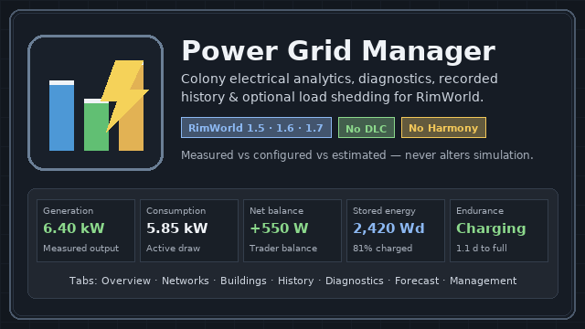
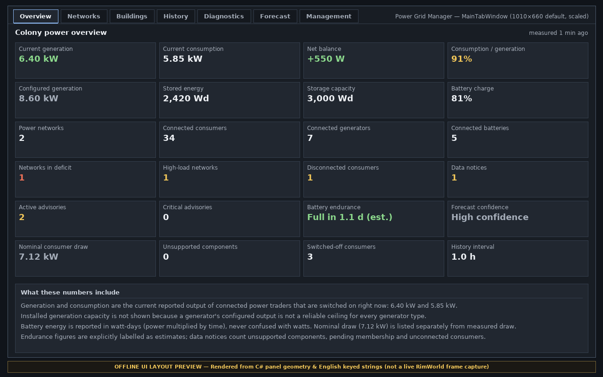
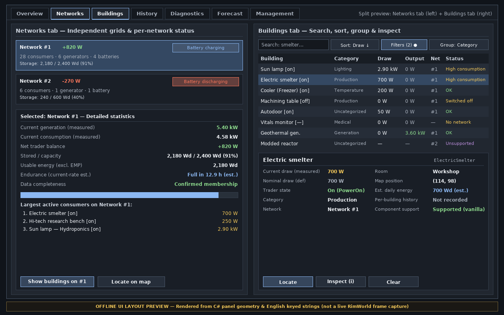
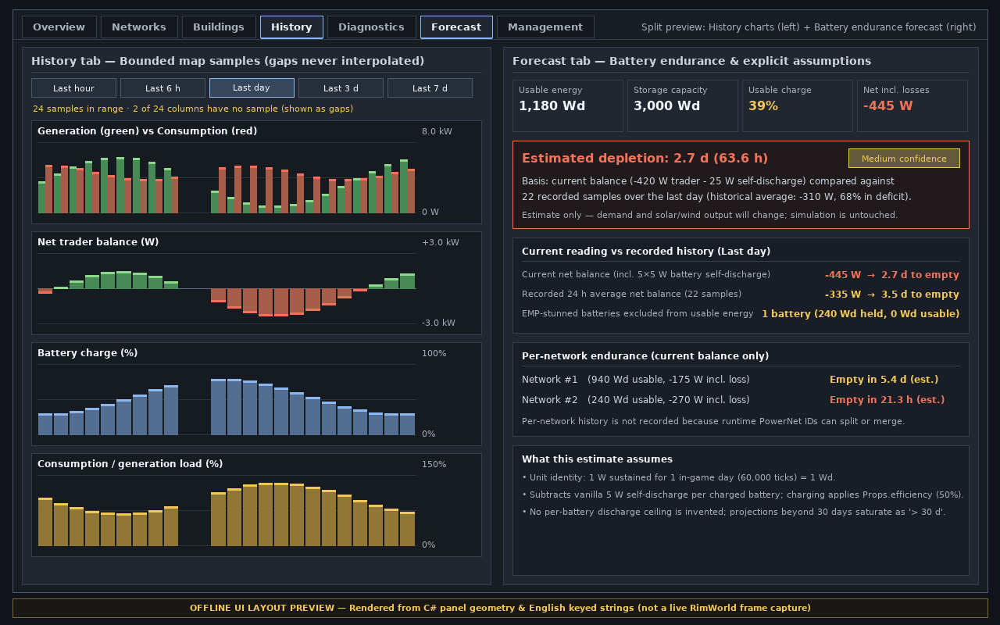
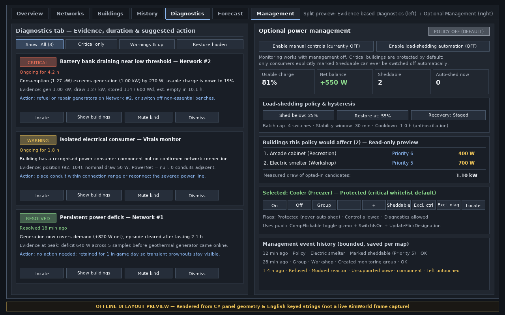

# UI Previews & In-Game Screenshot Guide

> **Provenance disclosure:** Because no RimWorld installation or graphics runtime is present in the automated build environment, the four images below are **offline UI layout previews** rendered directly from Power Grid Manager's C# panel geometry (`Source/PowerGridManager/UI/*.cs`), `PowerUiDraw` colour palette, and `Languages/English/Keyed/PowerGridManager.xml` strings. They illustrate the exact information hierarchy, column structure, chart series, and labelling contracts, **not** live RimWorld screenshots. Follow Section 3 below to capture live in-game screenshots once built against an installed copy of RimWorld.

---

## 1. Steam Workshop & Mod Manager Banner (`About/Preview.png`)

Used automatically by RimWorld's Mod Manager (`Page_ModsConfig`) and Steam Workshop uploader (`640×360` PNG).

---

## 2. Dashboard Panel Layout Previews

### 2.1 Overview Tab — 24-Tile Colony Summary & Measurement Contract

Shows measured generation, measured consumption, net trader balance, load ratio, configured def-level generation, stored battery energy (`Wd`), storage capacity (`Wd`), charge percentage, topology counts, deficit/high-load network counts, disconnected consumers, data notices, active/critical advisories, battery endurance with confidence rating, nominal draw, unsupported component counts, switched-off consumers, history sampling cadence, and the inline explanation panel.

### 2.2 Networks Tab & Buildings Tab — Grid Breakdown, Filtering & Inspection

- **Left (`Networks`):** Independent `PowerNet` list with status pills, battery energy/charge bars, endurance estimate, top active consumers, **Show buildings on #N**, and **Locate**.
- **Right (`Buildings`):** Search box, stable sort menu, combinable filters, room/category/network grouping, flick-state markers, text+colour statuses, and the selected-building detail card comparing measured vs nominal draw with **Locate** and **Inspect**.

### 2.3 History Tab & Forecast Tab — Bounded Time Series & Battery Endurance

- **Left (`History`):** Four native charts (*Generation vs Consumption*, *Net Balance*, *Battery Charge %*, *Load %*) across selectable in-game ranges (`1 h` to `7 d`), showing missing sample intervals honestly as visual gaps rather than interpolated lines.
- **Right (`Forecast`):** Battery depletion/charging projection accounting for `5 W`/battery self-discharge, charging efficiency, and EMP-stunned batteries, with confidence rating (`High`/`Medium`/`Low`), current-vs-historical comparison, per-network endurance, and explicit assumptions.

### 2.4 Diagnostics Tab & Optional Management Tab — Advisories & Load Shedding

- **Left (`Diagnostics`):** Severity-ranked advisory cards (*Critical*, *Warning*, *Info*, plus *Resolved* retention) carrying numeric descriptions, supporting evidence, duration, suggested action, and **Locate** / **Show buildings** / **Mute** / **Dismiss** controls.
- **Right (`Management`):** Disabled by default (`POLICY OFF`), with separate master switches for manual controls and hysteresis load-shedding automation, read-only **"Buildings this policy would affect"** preview, user-defined monitoring groups, per-building priorities (`1–6`), critical-building protection by default, and a bounded event audit log.

---

## 3. Capturing Live In-Game Screenshots for Release / Steam Workshop

Once `PowerGridManager.dll` is built with `./build.sh` and installed into a clean **no-DLC** RimWorld 1.6 profile at `1920×1080` (`UI scale 1x`):

1. **Colony Overview (`Overview` tab):** Load a mid-size colony with two separate networks (e.g. main grid + isolated outpost), solar/wind/geothermal generators, and a battery bank. Open the **Power** tab and capture `Overview`.
2. **Networks & Deficit Status (`Networks` tab):** Select a network experiencing battery discharge or high load so the right-hand detail pane displays the charge bar, endurance line, and largest active consumers.
3. **Searchable Building Explorer (`Buildings` tab):** Group by **Category** or **Room**, select an active production bench so the bottom detail card shows Measured vs Nominal draw, room, coordinates, and daily estimate, and capture.
4. **Multi-Day History (`History` tab):** Run the colony for 1–3 in-game days so solar day/night cycles populate all four charts, switch range to **Last day** or **Last 3 days**, and capture.
5. **Actionable Diagnostics (`Diagnostics` tab):** Trigger a genuine deficit or disconnect one consumer's conduit, wait one refresh (`~2 s` at `1x`), and capture the resulting advisory cards alongside a recently resolved episode.
6. **Battery Endurance (`Forecast` tab):** Capture during dusk/night battery discharge with `Last day` history selected so both current-rate and historical-average comparisons are visible.
7. **Optional Management Preview (`Management` tab):** Create two monitoring groups (e.g. `Workshop`, `Recreation`), mark two non-critical consumers `Sheddable` with priorities `5` and `6`, and capture the read-only affected-buildings preview and event log.
